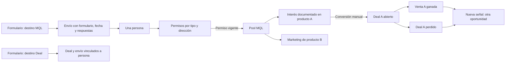

# Gestión de MQL en Cream CRM

Revisión crítica del 9 de septiembre de 2026, contrastada con `MARKETING.md` y el código actual. Actualizada para incluir formularios con destino MQL y consulta bidireccional MQL ↔ formularios en esta entrega. Este documento propone la implementación; las tareas siguen pendientes.

## 1. Qué debe corregirse del plan inicial

| Prioridad | Hallazgo y evidencia local | Corrección |
|---|---|---|
| Alta | `MARKETING.md` define MQL por permiso y admite cliente + MQL simultáneos. Filtrar únicamente `Person.lifecycle_stage == "mql"` excluye suscriptores autorizados y clientes. | Separar elegibilidad de marketing, interés por producto y oportunidad comercial. |
| Alta | `ScoringEngine::LIFECYCLE_THRESHOLDS` promueve a `sql` con 60 puntos y a `opportunity` con 80, sin crear deals. Tras un descenso a MQL podría volver a subir en la siguiente evaluación. | El lifecycle existente no será la fuente de verdad del pool ni se reescribirá en cada vuelta comercial. |
| Alta | `Deal.open_deals` depende de `PipelineStage.closed`. El modelo no tiene un evento de entrega del proyecto. | Ganar, perder y terminar la prestación son hechos distintos. Eliminar `customer sin deal → mql` y no deducir entrega de `won`. |
| Alta | `product_interest_id` a través de `deal_products` solo encuentra historia comercial. `LeadFormSubmissionProcessor#call` ya crea/reutiliza deal y `LeadSubmission` requiere deal. | Añadir destino MQL sin deal, conservar envíos vinculados a persona/formulario y registrar interés previo por producto cuando corresponda. |
| Alta | `EmailSubscription` distingue subscribed/pending/unsubscribed; `EmailSuppression` bloquea por dirección. `SendGuard` permite sin tipo y omite consentimiento si su flag está apagado. | Elegibilidad explícita y estricta; un badge de lifecycle o una fila de suscripción no bastan. |
| Alta | La propuesta no autorizaba persona, deal ni referencias. `DealPolicy::Scope` restringe deals por responsable/colaboración. | Aplicar Pundit y aislamiento de workspace, incluyendo filtros, contexto, enlaces y detección de oportunidades existentes. |
| Alta | Una transacción no evita dos POST que creen dos deals. | Persistir el interés y usarlo como identidad de conversión con bloqueo y resultado reutilizable. |
| Media | `_quick_deal_form` publica a `deals_path` y depende de `DealsController#apply_quick_deal_from_person!`. Un POST no sirve también como carga inicial del formulario. | GET para preparar, POST para convertir; extraer campos compartidos manteniendo la semántica de cada formulario. |
| Media | `JourneyRunner` no tiene salida por oportunidad/producto. `Person#after_update` y `ScoringEngine` llaman ambos al trigger de lifecycle, que crea enrollments de forma síncrona. | No sumar otro disparo ni basar la salida en cambios de lifecycle. Añadir salida explícita por producto. |
| Media | `AttributionReport` cuenta MQL mediante etapas de scoring y deals mediante `campaign_id`. El plan atribuía por UTM sin regla determinista. | Conservar y etiquetar la métrica histórica; separar métricas operativas y atribuir solo con evidencia inequívoca. |

## 2. Decisiones de dominio

### Tres dimensiones independientes

1. **Pool de marketing:** personas con al menos una suscripción `subscribed` a un tipo activo, email principal válido y sin supresión de esa dirección. Al seleccionar un tipo, se exige permiso para ese tipo concreto. `pending`, `unsubscribed`, ausencia de fila y tipos inactivos no habilitan comunicaciones.
2. **Interés por producto:** señal explícita con producto, fecha, descripción y quién la registró. Puede existir sin deal y no supone consentimiento. Una persona puede tener varios intereses y varias vueltas para el mismo producto.
3. **Situación comercial:** deals asociados a la persona y sus líneas de producto. La oportunidad abierta representa el SQL operativo; un deal ganado representa una venta, sin acreditar entrega. Puede coexistir con pertenencia al pool.

`Person.lifecycle_stage` y `lead_score` permanecen compatibles con scoring, journeys e informes actuales. La nueva conversión no los modifica: su resultado se acredita mediante el deal y el interés convertido. Mostrar la columna como «Lifecycle (scoring)» y explicar que no equivale a una oportunidad abierta. Cambiar globalmente las siete etapas exigiría una migración independiente de reglas, informes y automatizaciones.

El criterio «en el ámbito de Entaina» no está formalizado en el código. En esta versión se delimita con filtros/segmentos de personas; no se inventa una cualificación por score ni se presume que la newsletter equivale a permiso general. La elegibilidad es una regla operativa del producto; no reconstruye pruebas de consentimiento que hoy no estén almacenadas.

### Pool y cola de trabajo

- **Vista inicial «Pool MQL»:** todas las personas elegibles, incluidas aquellas con deals abiertos o ventas previas.
- **Vista «Sin oportunidad abierta»:** subconjunto opcional. Con producto seleccionado excluye únicamente oportunidades abiertas de ese producto; sin producto excluye cualquier oportunidad abierta.
- **Vista «Intereses pendientes»:** personas con señales sin tramitar, ordenadas por fecha de señal; score global como ordenación secundaria opcional. No llamarlo scoring por producto.
- Las personas sin permiso siguen en Personas. Una solicitud comercial puede gestionarse desde el CRM aunque no permita marketing; la conversión desde el pool vuelve a comprobar la elegibilidad.

El pool no se abandona por vender. La cola sin oportunidad se recalcula con los deals existentes. Cerrar un deal no renueva permisos, no borra el interés convertido y no reinicia recorridos automáticamente.

## 3. Alcance

**Incluido:** formularios con destino MQL o deal, captura/enriquecimiento de personas sin crear deal, histórico de envíos, consulta de MQL por formulario y formularios por MQL, gestión del pool, filtros compartidos, interés manual o de formulario, conversión comercial manual, permisos y salida de nurturing por producto.

**Posterior:** API de captura independiente de los formularios actuales, importación/sync Beehiiv con evidencia de consentimiento, conversión automática a deal por señales, scoring por producto, SLA/asignación automática y evento de entrega de proyecto. La captura de lead magnets mediante los formularios de Cream sí forma parte de esta entrega.

No crear otro registro MQL 1:1 con Person ni otro catálogo de productos. Se necesitan migraciones para destino y consentimiento de formularios, envíos sin deal, intereses y configuración de salida de journeys.

### 3.1. Destino configurable del formulario

- Añadir `LeadForm.destination` con valores `deal` / `mql`, NOT NULL y default `deal`. Los formularios existentes conservan su comportamiento. El administrador del formulario elige «Destino: MQL / Deal»; nunca lo decide un parámetro enviado por el visitante.
- Destino **Deal**: mantener creación/reutilización actual de deal, contacto, producto y primera tarea. Destino **MQL**: crear o enriquecer persona, guardar el envío y procesar sus permisos; no crear, reutilizar, mover ni modificar un deal, aunque la persona ya tenga uno abierto.
- Pipeline, etapa, rutas por tipo de ayuda y primera tarea solo se aplican a destino deal. Hacer `lead_forms.pipeline_id` nullable y validar pipeline/tarea condicionalmente; ocultar esos campos para MQL y no ejecutarlos. Mantener responsable, plantilla, producto opcional, campos, redirect y respuesta configurada. No exigir producto para captar un MQL genérico.
- Cambiar destino solo afecta a envíos posteriores. Conservar la configuración comercial previa si se cambia a MQL, sin utilizarla; al volver a Deal, revalidarla antes de guardar.
- Con `mql_pool` o `marketing_consent` apagados, deshabilitar selección/publicación/envío de formularios MQL con respuesta controlada. Los formularios Deal siguen disponibles con su flag actual. Nunca convertir silenciosamente un formulario MQL en Deal al desactivar el módulo.

### 3.2. Persona ↔ formulario mediante cada envío

Reutilizar `LeadSubmission` como relación muchos-a-muchos con histórico: `LeadForm has_many :lead_submissions`, `Person has_many :lead_submissions`; asociaciones through para obtener personas/formularios distintos. No añadir un único `lead_form_id` a Person ni guardar solo el último formulario.

- Hacer `lead_submissions.deal_id` nullable y `belongs_to :deal, optional: true`. Persona, formulario y workspace siguen obligatorios. Persistir `capture_destination` (`mql` / `deal`) en cada envío: snapshot del destino al procesarlo, independiente de cambios posteriores de configuración.
- Cada envío nuevo válido genera una fila con respuestas, fecha, formulario y nombre/slug de ese momento, producto/edición resueltos cuando existan, UTMs y evidencia de consentimiento. Conservar `person.source` si ya estaba informado; el origen de cada envío vive en su propio registro.
- Un segundo envío de la misma persona al mismo formulario conserva otra fila; el listado de MQL muestra una persona con contador de envíos, primera y última fecha. Formularios distintos no se sobrescriben entre sí.
- Reintentos del mismo envío MQL deben ser idempotentes: identificador de envío emitido por el servidor, ligado al formulario y validado, con índice único parcial `(workspace_id, lead_form_id, submission_key)` para claves no nulas. Guardar también la identidad del contenido normalizado: misma clave con contenido distinto da conflicto. Un nuevo envío voluntario obtiene otra clave. No deduplicar por persona/formulario, porque borraría repeticiones legítimas. Tokens ausentes/invalidos se rechazan en MQL; formularios Deal antiguos mantienen compatibilidad.
- Deduplicar persona por email normalizado dentro del workspace, incluyendo `PersonEmail`, reutilizando la búsqueda existente. Serializar capturas MQL concurrentes por workspace/email antes de buscar/crear; no imponer unicidad global de email que cambie el modelo actual. Ante varios contactos coincidentes, aplicar la resolución existente sin fusionarlos automáticamente y registrar la ambigüedad para revisión interna; la respuesta pública no revela si el contacto existía. El bloqueo entre capturas MQL no garantiza exclusión con escritores legacy que no lo usen.
- Índices de consulta por `(workspace_id, lead_form_id, person_id, created_at)` y `(workspace_id, person_id, created_at)`, además de destino/FKs según consultas reales. Reasignar envíos en `PersonMerger` y conservar todos los formularios de ambas personas.
- Preservar histórico: formularios con envíos se desactivan (`active: false`), no se destruyen en cascada. Sustituir `LeadForm` → submissions `dependent: :destroy` por restricción. Borrar un deal anula su vínculo, sin borrar el envío ni alterar destino original. Ajustar `Deal` → submissions y FKs. Borrado de persona/workspace elimina sus envíos de forma coherente; no dejar filas huérfanas frente al NOT NULL de persona.
- Una conversión comercial posterior se enlaza a través de `ProductInterest` y su submission de origen; no reescribe `capture_destination` ni convierte el envío MQL en una captura Deal.

### 3.3. Captura, permiso y efectos sin deal

Separar `LeadFormSubmissionProcessor` en pasos comunes (validación, persona/empresa, envío, permisos y tracking) y rama comercial solo para destino deal. Mantener `Result(submission:, person:, deal:)` admitiendo `deal: nil`.

1. Conservar esquema de campos, honeypot, timestamp, Turnstile, límites y redirección segura existentes. La empresa sigue siendo obligatoria en Person: reutilizar la resolución actual y la empresa de particulares cuando corresponda, sin inventar un deal para satisfacer asociaciones.
2. Para formularios MQL, añadir selección de un `subscription_type_id` activo y texto de permiso de marketing configurable. Renderizar una aceptación explícita separada de `gdpr_consent`, mediante un campo permitido por `SubmissionSchema` y el renderer Liquid. Guardar en el envío tipo, respuesta, texto/versión mostrado, fecha y formulario. No deducir suscripción general de aceptación de privacidad o descarga. Si hay opción newsletter adicional, procesarla como permiso separado sin duplicar suscripciones.
3. Con permiso otorgado, registrar la suscripción a ese tipo mediante `ConsentService`; sin permiso o con estado pendiente/supresión, conservar persona y envío como contacto captado, mostrar su estado y no incorporarlo al pool elegible por ese envío. Si ya tiene otro permiso vigente puede seguir en el pool. No borrar bajas/supresiones por recibir otro formulario ni reactivar una baja previa mediante esta captura; la reactivación exige el flujo explícito de preferencias/confirmación. No implementar doble opt-in ficticio: pending solo será elegible cuando exista confirmación.
4. Si el formulario MQL tiene producto, registrar un interés con `source_kind: lead_form`, referencia al envío y fecha de recepción; una captura sin producto no crea interés artificial. Ese interés no crea un SQL automáticamente. Evitar duplicación con unicidad del interés automático por submission/producto.
5. Reutilizar eventos `lead_submission` / `form_field` y trigger `lead_form_submitted` con la identidad del formulario, una vez por envío aceptado, también sin deal. Los triggers pueden usar la señal para entrar en journeys configurados, respetando permisos, salida comercial y límites de reinscripción; el score no obliga a crear deal. Encolar nuevos efectos externos tras commit y probar reintentos/rollback.
6. Adaptar correo de respuesta para `record: person` en MQL y `record: deal` en Deal. Revisar `enqueue_emails`, `NotificationService.notify_lead_submission`, `LeadFormMailer` y sus vistas: enlace a persona/envío cuando no hay deal. Llamadas de IA comercial, tareas y automatizaciones específicas de deal solo en rama Deal. El correo de entrega/respuesta solicitado sigue su finalidad; no usarlo como vía para campañas sin permiso.
7. Atribución en MQL: conservar UTMs y campaña explícita verificada en submission, sin crear campaña por texto UTM; cuando se convierta, aplicar la regla de la sección 7. La rama Deal conserva por ahora su comportamiento actual de atribución. Auditar demás consumidores de `LeadSubmission` para que no presupongan deal.

### 3.4. Consultas y navegación en ambos sentidos

- **Desde un formulario:** añadir ficha `LeadFormsController#show` con pestaña «MQL captados» sobre personas distintas con envíos cuyo `capture_destination == "mql"`. Mostrar nombre, permisos actuales, primera/última captura y número de envíos de ese formulario. Incluir contactos captados que posteriormente pierdan permiso o pasen a ventas, con estado explícito y filtro «Elegibles actualmente». Así no desaparece el histórico. Separar recuento de personas captadas, elegibles y envíos.
- En esa ficha, pestaña «Envíos» con respuestas y destino de cada envío, incluidos los de destino Deal; filtrar por fechas y destino. Un formulario que cambie de destino conserva ambos históricos. En el índice de formularios, mostrar destino y enlace a captados.
- **Desde el pool:** filtro «Formulario» y columna/resumen «Formularios» con enlaces autorizados; una persona con varios envíos aparece una vez. El pool conserva su regla de elegibilidad actual, aunque la ficha del formulario conserve captados históricos.
- **Desde la ficha MQL/persona:** sección «Formularios enviados» para todos los formularios de la persona, agrupados por formulario, con primera/última fecha, contador y detalle de cada envío (respuestas, destino, permisos y producto). Sigue visible después de convertirse a SQL/cliente. Añadir `GET /people/:person_id/lead_submissions/:id` para detalle autorizado, sin crear una ficha MQL duplicada.
- Nombre/identidad de formulario guardados al captar y enlace a la configuración actual cuando esté autorizada; no exponer respuestas personales en rutas públicas ni a usuarios sin acceso a la persona. Ver formulario exige `LeadFormPolicy#show?`; listar/detallar envíos exige también acceso a las personas. En ficha de persona, mostrar procedencia a quien pueda verla; el enlace de administración requiere además permiso de formulario.
- Paginar captados y envíos por separado, agrupar recuentos en SQL y precargar formularios. Respuestas y nombres escapados; no mostrar metadata técnica sensible como parte del listado ordinario.

## 4. Elegibilidad y filtros compartidos

Crear `Marketing::MqlEligibility` con consulta de personas y comprobación individual para la conversión. Reutilizar esa regla desde `Marketing::FilterResolver`; evitar definiciones distintas entre pantalla y segmentos.

- Dirección de esta versión: `person.email`, que usa el envío actual. Normalizar como `EmailSuppression`; no recurrir automáticamente a emails secundarios. `exclude_suppressed` ya excluye también secundarios y se conserva por compatibilidad, pero no equivale exactamente a elegibilidad.
- Exigir `marketing_consent` para activar el pool. Con ese flag apagado, denegar acceso/operaciones del módulo; no heredar el comportamiento permisivo de `SendGuard`.
- Pertenecer al pool no autoriza enviar por cualquier tipo. Cada envío conserva su comprobación de tipo y supresión al ejecutarse. Convertir nunca cambia suscripciones ni limpia una supresión.

Contrato de filtros de Person, con claves únicas en vez de booleanos contradictorios:

| Clave | Semántica |
|---|---|
| `marketing_eligible` | Elegibilidad anterior; la pantalla lo fija a true sin permitir retirarlo mediante parámetros. |
| `subscription_type_id` + `subscription_status` | Estado de la misma suscripción del tipo elegido. subscribed/pending/unsubscribed y `missing` mediante ausencia de fila. En el pool se usa subscribed; otros estados son para segmentos. |
| `open_deal` | any / yes / no. any no restringe. |
| `open_deal_product_id` | Acota yes/no al producto indicado; no es interés. Requiere yes o no. |
| `interest_product_id` + `interest_status` | Interés explícito; estado por defecto pending al filtrar producto. |
| `dealt_product_id` | Historia de líneas de producto en deals; incluye abiertos, ganados y perdidos. |
| `lead_form_id` + `capture_destination` | Personas con envío del formulario indicado; destino any / mql / deal evaluado en el envío histórico, no en la configuración actual. Reutilizable en pool y segmentos. |
| `submitted_from` + `submitted_to` | Intervalo de recepción, aplicado a la misma submission que formulario/destino para evitar coincidencias entre envíos distintos. |
| `source`, `interest_from`, `interest_to` y filtros existentes | Origen nativo, intervalo inclusivo de señal en zona horaria de la aplicación, búsqueda y score; no confundir `source` con UTM. |

Validar enums, fechas, rangos e IDs; mostrar errores ante referencias ajenas o combinaciones inválidas, sin ignorarlas y ampliar silenciosamente la audiencia. Conservar segmentos existentes. Nuevas claves solo para Person.

Usar `EXISTS` / `NOT EXISTS` o subconsultas acotadas por workspace; evitar multiplicar filas, cargar todas las supresiones con `pluck` y paginar en memoria. Tipo y estado deben aplicarse a la misma suscripción. Producto y estado abierto deben referirse al mismo deal.

El filtro existente `submitted_form_slug` continúa funcionando para segmentos guardados. En nuevos filtros y enlaces usar ID estable; definirlo como alternativa a `lead_form_id`, rechazando valores contradictorios. Los filtros de formulario incluyen tanto MQL como Deal salvo destino explícito. La acción «MQL captados» fija el destino histórico mql.

Exponer campos y descripciones en `app/views/segments/_form.html.erb` y `MarketingHelper#describe_segment_filters`. La preview actual cuenta filtros guardados: mantener ese mensaje. No sustituir en esta fase todo `PeopleController#index`, que también sirve vistas guardadas y selectores JSON.

**Visibilidad comercial:** pantalla sobre `policy_scope(current_workspace.people)`, con deals filtrados por `DealPolicy::Scope` y etiqueta «oportunidades visibles». Los segmentos administrados por usuarios autorizados y las comprobaciones internas de nurturing/conversión evalúan todos los deals del workspace. Pasar al resolver el scope de deals de forma explícita según su consumidor. No revelar nombres, importes o IDs ocultos. Si hay colisión no visible, devolver un mensaje genérico para coordinarse con un administrador. La cola visible puede mostrar una persona cuya conversión resulte bloqueada por esta comprobación interna; documentar esa diferencia.

## 5. Registro mínimo de interés

Nuevo `Marketing::ProductInterest` (tabla `marketing_product_interests`):

- `workspace_id`, `person_id`, `product_id`, `recorded_by_id`, `occurred_at`, `description` y timestamps.
- `status`: pending / converted / dismissed; `dismissal_reason` obligatorio al descartar.
- `deal_id` opcional, `converted_at` y `converted_by_id` para la resolución comercial.
- `source_kind` manual / lead_form y `lead_submission_id` opcional, obligatorio en señal de formulario. Índice único parcial por submission/producto para señales automáticas; varios envíos legítimos pueden generar intereses distintos.
- `metadata` JSONB acotado para referencias de evidencia y snapshot, con `schema_version`. Referencias de formulario/email resueltas en servidor, correspondientes a la persona/workspace y visibles para el actor.

Producto, señal y fecha son obligatorios. Autor obligatorio para alta manual; en captura automática la procedencia es el formulario/envío, sin atribuir la acción a su responsable como si la hubiera ejecutado. La descripción recoge qué pidió/hizo el contacto, no solo «score alto». No convertir automáticamente una apertura ni inferir interés pendiente de una compra antigua.

Claves foráneas, NOT NULL donde corresponda, CHECK de estados y consistencia de resolución; validar workspace de todas las referencias. Índices iniciales `(workspace_id, person_id, status)` y `(workspace_id, product_id, status, occurred_at)`, además de FKs. No imponer unicidad persona/producto: impediría recurrencia.

Un interés convertido es inmutable en origen. Otra vuelta crea otro interés. Si se elimina el deal, conservar snapshot, fecha y estado convertido, anulando vínculo: un reintento no debe recrear la venta. Respetar borrado de persona/workspace; extender `PersonMerger` para reasignar intereses al fusionar contactos. Restringir borrado de productos referenciados. Permitir anonimizar la referencia a un autor eliminado conservando fecha y señal; sus FKs deben admitirlo.

## 6. Pantalla, rutas y permisos

- Registrar `:mql_pool` inicialmente apagado, con campos completos de `CreamFeatures::REGISTRY`, ruta e icono. Añadirlo a `SidebarMenu::CANONICAL_KEYS_BY_GROUP[:marketing]`, respetando orden guardado.
- `MqlsController#index`, `resources :mqls, only: :index`; aplicar `RequiresFeature` en el controlador, no en el router.
- Rutas de intereses bajo persona: listar/crear/descartar y `GET .../:interest_id/conversion/new`, `POST .../:interest_id/conversion`. Controladores dedicados con gating; no bloquear todo `PeopleController` por esta función.
- Política del pool para miembros que pueden consultar personas. Crear/descartar intereses exige actualizar esa persona. Conversión exige además `DealPolicy#create?`; vinculación, `DealPolicy#update?` del destino. Segmentos y configuración de journeys mantienen sus permisos actuales.
- Resolver persona, interés, producto, pipeline, etapa, campaña y responsables mediante scopes autorizados. No aceptar workspace, empresa, contacto, estado convertido o autor desde hidden inputs como autoridad.
- Tabla paginada: persona/empresa, formularios de procedencia, permisos por tipo, intereses pendientes, oportunidades visibles, última señal y score. Evitar badge genérico «consentimiento sí». Orden estable con desempate por ID, columnas permitidas y cargas agrupadas contra N+1.
- «Última señal» usa fechas de intereses/interacciones seleccionadas, no `activities.maximum(:created_at)`: activities incluye ediciones internas y scoring.
- En fila y ficha: registrar interés; desde uno pendiente, «Convertir a SQL». Mostrar producto y señal antes de crear deal. Errores inline 422 preservando valores; conflictos 409 con salida accionable; GET sin mutaciones; HTML y Turbo.
- Vacíos: sin permisos vigentes, sin intereses, filtros sin resultados, sin productos o sin pipeline apto. Enlaces de configuración solo para quien tenga permiso.

## 7. Conversión transaccional y trazable

`Marketing::MqlToSqlConverter.call(interest:, actor:, attributes:)`, con resultado explícito: created / linked / already_converted / conflict / invalid.

### Preparación

Producto obligatorio desde el interés. Pipeline elegido por usuario: `Product` no tiene pipeline configurado, por lo que no debe prometerse enrutamiento automático. Preseleccionar actual/default si es apto; comprobar existencia y primera etapa abierta. Si no lo es, pedir otro pipeline o corregir configuración; no elegir una etapa cerrada.

Próxima tarea obligatoria con título, fecha hoy o posterior y responsable del workspace. Responsable del deal por defecto actor; una asignación alternativa debe dejar un resultado consultable por el actor según políticas existentes. Conservar precio de catálogo, cantidad y recálculo de valor mediante `DealProduct`.

Extraer campos compartidos de `_quick_deal_form` sin copiar `DealsController` ni el procesador de formularios. El nuevo formulario tiene URL, encabezado y errores propios. Mantener funcionando «New deal» y su endpoint actuales.

### Algoritmo

1. Autorizar y validar referencias. Abrir transacción y bloquear persona e interés en ese orden; todas las conversiones nuevas usan ese orden para serializar acciones sobre una persona.
2. Si ya está convertido, devolver el mismo resultado sin crear actividad, tarea o deal. Si se eliminó el deal, devolver estado histórico sin recrearlo. Reintento con destino/parámetros comerciales incompatibles: conflicto, sin modificar conversión. No mostrar destino si el actor perdió acceso. Guardar la intención de conversión normalizada para comparar reintentos, sin incluir campos volátiles.
3. Revalidar interés pending y elegibilidad actual desde la base de datos. Un cambio de consentimiento posterior al commit se aplica en envíos; no se promete atomicidad con todos los escritores actuales de consentimiento.
4. Buscar oportunidades abiertas para persona + producto en todo el workspace. Si hay alguna, no crear otra automáticamente: ofrecer vincular a una visible/autorizada que ya contenga persona y producto. Varias: elección explícita. Solo ocultas: conflicto genérico. Otro producto no bloquea.
5. Si no hay colisión, crear deal, contacto, línea y tarea conjuntamente. Empresa desde persona; tarea construida antes del primer save para satisfacer `has_a_future_task`. No usar `duplicating` ni saltarse validaciones. Comprobar condiciones aplicables de entrada: actualmente el modelo solo las evalúa al cambiar etapa de un deal persistido.
6. Marcar interés convertido y persistir destino, actor, fecha y snapshot. Actividad en persona y deal con el mismo `interest_id`, pasando `user: actor`. Vinculación: actividad diferenciada, sin nueva tarea ni sobrescribir campaña. Registrar si creó o vinculó para métricas y reintentos.
7. Cancelar enrollments de nurturing aplicables según la sección siguiente, dentro de la misma transacción. Un fallo de persistencia revierte todo.
8. Después del commit, reconciliar segmentos mediante job reintentable. Encolar efectos externos nuevos tras commit; no HTTP desde converter. No invocar triggers de lifecycle ni sumar puntos por reintentos.

**Concurrencia:** dos solicitudes del mismo interés producen un resultado; dos intereses simultáneos de persona/producto detectan la oportunidad creada por el primero en este flujo. Las altas actuales vía formulario/API/CRM no comparten bloqueo: no afirmar unicidad global. Impedir duplicados entre todos los canales exigiría un coordinador común y adaptar esos escritores; no añadir un índice persona/producto que impida oportunidades legítimas simultáneas.

### Contexto visible y atribución

Snapshot limitado: señal, producto, autor/procedencia automática, fechas, `Person.source`, score/lifecycle observados, referencia de origen, UTMs acreditadas y resumen de hasta 10 interacciones recientes y 10 enrollments relevantes, con fechas/estados. Si procede de formulario, incluir `lead_form_id`, nombre/slug al captar y `lead_submission_id` de la señal elegida; no tomar arbitrariamente el último formulario de la persona. Un enrollment no demuestra recepción de email: etiquetarlo como participación en recorrido; describir un envío solo con evidencia de envío.

No copiar cuerpos de correo, IP ni historiales completos. Referencias pueden desaparecer por retención; el resumen debe seguir legible. Mostrar contexto en deal y persona, con texto específico en `activity_sentence`; almacenar metadata sin renderizarla no satisface el traspaso.

Asignar `campaign_id` solo al crear deal y si la evidencia elegida contiene campaña explícita válida del workspace. Solo texto UTM o varias candidatas: conservarlo en snapshot y dejar campaña vacía; no crear campañas ni elegir por nombre. No reutilizar la creación automática de campaña del procesador de formularios.

## 8. Recurrencia y salida de nurturing

Eliminar `Marketing::LifecycleSync` y el hook que baja clientes a MQL. La cola consulta datos actuales: cierres, reaperturas, cambios de contactos/productos y borrados se reflejan sin mantener otro estado comercial global.

| Hecho | Pool / intereses | Recorridos |
|---|---|---|
| Se abre deal A | Sigue en pool con permiso; sale de «sin oportunidad A». Interés convertido. | Salida de nurturing A si está configurada. B y newsletter siguen sus permisos. |
| Deal A ganado | Conserva venta e historial; no presume entrega ni baja lifecycle. | No reinscribe automáticamente. |
| Deal A perdido | Vuelve a «sin oportunidad A» si no hay otro abierto A y conserva permiso. Interés previo sigue convertido. | No reinscribe automáticamente. |
| Se reabre deal A | Deja de cumplir «sin oportunidad A». | La comprobación previa a ejecutar vuelve a bloquear nurturing A. |
| Nueva señal A o B | Nuevo interés; de nuevo permisos y detección de oportunidades. | Nueva vuelta solo explícita o por señal configurada. |
| Baja/supresión | Sale del pool al perder elegibilidad; no borra ventas. | Cada envío revalida permiso/supresión. |

Añadir a `Journey` `product_id` opcional y `stop_on_open_deal` booleano (default false), validando producto obligatorio si se activa. No meterlos en `entry_config`, dedicado a coincidencias del trigger. Exponerlos en formulario y parámetros autorizados.

- Converter: cancelar active/waiting del producto con salida activada; guardar motivo, deal y fecha de cancelación en metadata del enrollment.
- `JourneyTrigger` y entrada manual: no inscribir en esos recorridos con deal abierto del producto. `JourneyRunner`: comprobar al avanzar y antes de enviar para cubrir altas/reaperturas desde otros canales. Cancelación idempotente.
- La inscripción explícita debe dirigirse solo al recorrido autorizado y seleccionado. Revisar `JourneysController#enroll`: hoy llama a `JourneyTrigger.trigger!("manual", person:)` sin acotar el journey (y sin namespace `Marketing`); no reutilizar esa llamada como inscripción individual fiable.
- Coordinar bloqueo del enrollment entre converter y runner para no cancelar y avanzar el mismo estado simultáneamente. Límite práctico: un correo ya entregado al proveedor no puede retirarse; probar el caso aún pendiente.
- **Reentrada:** `SegmentWatcher` puede disparar una inscripción al reaparecer en un segmento tras perder un deal. Para un recorrido con salida comercial registrada, bloquear reentrada automática por segmento/cierre. Una nueva señal documentada o inscripción manual explícita permite otra vuelta, respetando el límite del journey. En esta versión no añadir un editor genérico de reglas de reentrada: acción manual que documenta el motivo y consulta el histórico de cancelación. Los intereses manuales no disparan enrollments por sí solos.
- Recorridos existentes conservan comportamiento por defecto. No cancelar todos los journeys ni prometer salida ante respuesta/reserva hasta implementar esas condiciones.

Los segmentos se resuelven con datos actuales, pero `SegmentMembership` es una proyección actualizada mediante `SegmentWatcher`, no una garantía de consulta en vivo. Añadir reconciliación tras commit para nuevos envíos de formularios y cambios relevantes de consentimiento/supresión, intereses y deals (creación, etapa, contactos, productos y borrado). No basarla solo en `move_to_stage!`, que no cubre esas vías. Jobs idempotentes con persona/workspace explícitos y sin disparo en rollback; cubrir también cambios de configuración de tipos y de `closed` en etapas. Agrupar operaciones masivas en lotes. Evitar reentradas de nurturing por estas reconciliaciones conforme a la regla anterior.

## 9. Verificación y aceptación

| Área | Casos mínimos |
|---|---|
| Destino formulario | MQL crea persona/envío sin deal ni tarea, incluso con deal abierto previo; sin producto/pipeline; Deal conserva creación/reutilización actual; destino manipulado en POST no tiene efecto; cambio de destino solo afecta nuevos envíos; flags apagados no desvían capturas a Deal. |
| Trazabilidad formulario | Una persona en dos formularios; varios envíos al mismo formulario con una sola fila de persona; formulario renombrado/desactivado; SQL/cliente o baja posterior conservan histórico; fusiones conservan todos los envíos; borrado de deal no elimina origen; personas/envíos de otro workspace inaccesibles. |
| Captura y consentimiento | Privacidad sin opt-in no suscribe; tipo y texto correctos; newsletter separado; ausencia/pending/baja/supresión; duplicados por email secundario; capturas concurrentes; reintento no duplica envío/interés/score/notificación; nuevo envío sí conserva nueva evidencia. |
| Efectos sin deal | Correo asociado a persona y enlaces de notificación correctos; plantillas/redirect/antispam existentes; journeys por formulario y atribución sin deal; ausencia de llamadas comerciales sobre nil; rollback sin efectos externos. |
| Elegibilidad | subscribed/pending/unsubscribed/missing; tipo inactivo; newsletter sin general; principal vacío/suprimido; secundario suprimido; consent flag apagado; baja entre GET y POST. |
| Dimensiones | Cliente autorizado en pool; score alto sin deal no equivale a SQL operativo; venta A compatible con interés B; lifecycle/scoring sin cambios por conversión/cierre. |
| Filtros | Producto/estado en mismo deal; tipo/estado en misma suscripción; formulario/destino/fecha en mismo envío; IDs estables tras renombrar; sin duplicados; rangos/IDs inválidos; otro workspace; segmentos guardados/preview y deals ocultos. |
| Intereses | Señal previa a deal; productos y vueltas múltiples; descarte; inmutabilidad tras conversión; fusión/borrado de persona y borrado de deal/producto/autor. |
| Conversión | Producto+tarea+precio; pipeline sin etapa abierta; referencias ajenas; permisos; condiciones de etapa; fallo de tarea/actividad revierte todo. |
| Idempotencia | Doble clic/reintento tras timeout; POST concurrentes del mismo interés y de dos equivalentes; parámetros distintos; deal borrado/acceso revocado. Usar conexiones separadas y barreras, no solo dos llamadas secuenciales. |
| Deal existente | Vincular sin duplicar tarea/campaña; elección entre varios; conflicto genérico con oculto; otro producto no bloquea. |
| Contexto | Señal/actor visibles en persona/deal; referencias purgadas; sin datos ajenos; campaña explícita/ausente/ambigua; conversión cuenta una vez aunque tenga dos actividades. |
| Journeys | Cancelar solo producto configurado; runner/trigger/manual respetan salida; reapertura/alta por otro canal; no reentrada por cierre; nueva vuelta explícita; flag apagado y recorridos existentes. |
| Proyecciones | Cambio de suscripción/supresión, producto/contacto/etapa y borrados actualizan segmentos tras commit; reintento no duplica inscripción; rollback no dispara reconciliación. |
| UI / acceso | GET sin mutaciones; HTML/Turbo; paginación estable; no miembro; sidebar con orden guardado; flag apagado; botones según permisos; vacíos. |

Specs nuevos para eligibility, intereses, converter y consultas bidireccionales; ampliar `spec/models/lead_form_spec.rb`, `spec/services/lead_form_submission_processor_spec.rb`, `spec/requests/lead_forms_spec.rb`, `spec/requests/public/lead_forms_spec.rb`, plantillas Liquid/esquema, correo/notificaciones, filter_resolver, journeys, person_merger, sidebar y regresiones de deals. Adaptador de jobs de test restaurando el anterior; simular HTTP/ESP. El trigger actual crea enrollments sin jobs: comprobar también filas, no solo cola.

Comandos previstos durante implementación: `bundle exec rspec spec/services/marketing spec/requests/marketing_admin_spec.rb`, nuevas specs y regresiones afectadas, más `bundle exec rubocop` sobre Ruby modificado. Se modifican modelos comunes: ejecutar además `bundle exec rspec` antes de activar. Smoke de navegador: configurar formulario MQL → enviar con permiso → consultar MQL desde formulario → ver formularios/envíos en persona → repetir envío y enviar otro formulario → convertir interés A → perder deal → nueva señal. Añadir formulario Deal existente y venta A/interés B simultáneos. Comprobar consultas de una página con datos representativos y ajustar índices según consultas reales.

Esta revisión documental se verifica revisando estructura, referencias y coherencia del plan; no requiere ejecutar aplicación ni migraciones.

## 10. Entrega y despliegue

1. **Datos y reglas:** migrar destino de formularios, tipo/texto de consentimiento, pipeline opcional, deal opcional en submissions, destino capturado, clave de idempotencia, FKs e intereses; elegibilidad/filtros y políticas con flag apagado. Backfill de `LeadForm.destination` y `LeadSubmission.capture_destination` a `deal` para datos legacy, con CHECK/NOT NULL; no inventar consentimiento, intereses ni lifecycle a partir de scores/deals.
2. **Captura y gestión:** selector MQL/Deal, procesamiento bifurcado, respuestas/notificaciones sin deal y consulta bidireccional formulario/persona; pool, ficha de intereses, converter y contexto. Regresiones de formularios existentes y «New deal». Revisar flujo completo con flag habilitado en pruebas.
3. **Recorridos:** configuración opcional, bloqueo de ejecución/entrada, reconciliación de segmentos y reentrada controlada. Requisito antes de presentar integración con nurturing.
4. **Validación:** recuentos agregados de suscripciones activas, elegibles, lifecycle SQL sin deal y personas con varios deals; ejecutar matriz y revisar permisos/consultas.
5. **Documentación y activación:** actualizar `MARKETING.md` distinguiendo implementado/pendiente y dimensiones; `.claude/skills/cream-streak-roadmap/TRACKING.md`, `.claude/skills/cream-marketing/SKILL.md`, `MANUAL_USUARIO.md` y `USER_MANUAL.md` §29. Marcar ready solo tras validar.

`CreamFeatures.enabled?` es configuración global estática, no un flag por workspace. Verificar primero en pruebas y después activar globalmente; un piloto por tenant exigiría implementar esa capacidad aparte. Aplicar migraciones antes de desplegar código que las consulta. Para desactivar, apagar `mql_pool` conservando envíos, intereses, deals y evidencia; no revertir datos comerciales. Formularios MQL quedan temporalmente indisponibles con mensaje controlado, sin crear deals como fallback; los Deal siguen operativos. Documentar que su salida específica de journeys deja de aplicarse con el flag apagado y que siguen los controles existentes de envío. Mantener resolución de nuevos filtros guardados, sin convertirlos en filtros vacíos. Una vez haya submissions sin deal, no restaurar código antiguo que lo asuma obligatorio ni reponer NOT NULL sin un procedimiento de compatibilidad.

Métricas iniciales: por formulario, personas captadas distintas, elegibles actualmente y número de envíos; globalmente, personas elegibles, intereses pendientes, intereses convertidos a deal nuevo, vinculaciones y tiempo señal→conversión. No sumar captados de cada formulario para obtener personas únicas globales: una misma persona puede aparecer en varios. Contar envíos desde submissions y conversiones desde intereses, no activities. El informe actual mantiene su métrica basada en etapas, identificada como tal; no renombrarla como tamaño del pool ni mezclar personas con conversiones repetidas. Tasas por cohorte y atribución avanzada quedan para después.

### Decisiones propuestas que deben quedar visibles en la revisión funcional

- Lifecycle legacy separado de la operación comercial; ninguna vuelta baja customer a mql.
- Cola sin oportunidad por producto; pool conserva clientes y personas con ventas activas.
- Formularios con destino MQL o Deal desde esta versión, histórico por envío y navegación en ambos sentidos; conversión MQL→SQL manual.
- Pipeline explícito, dirección principal y ninguna reinscripción automática por cierre.

Estas decisiones sustituyen hipótesis contradictorias del plan inicial. Si se exige modelar «proyecto en ejecución/entregado» antes de activar, añadir un evento/estado de ejecución explícito y sus integraciones; no aproximarlo con ausencia de deals abiertos.
