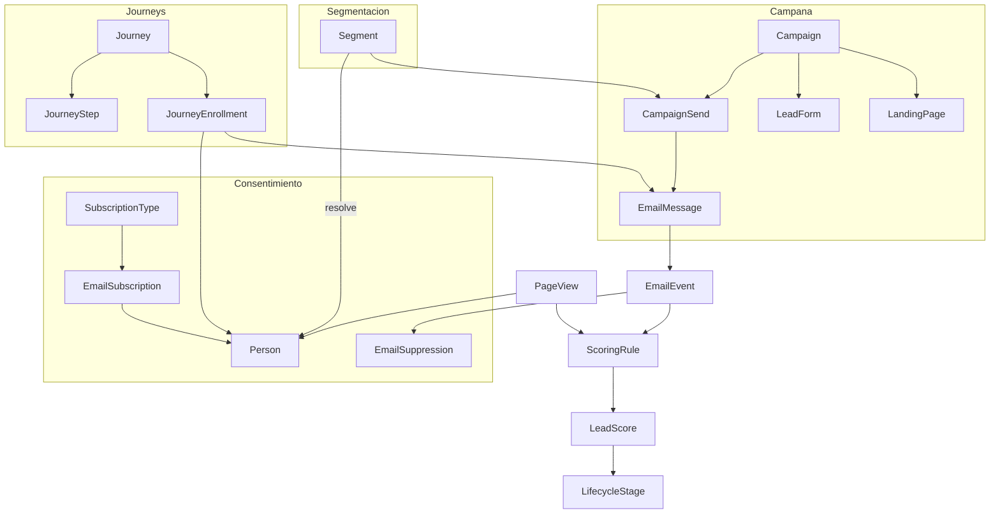

# Marketing en Cream: paridad selectiva con HubSpot

## Punto de partida

Cream ya tiene piezas de marketing sueltas que nadie ha conectado entre sí:

- **Captación**: `LeadForm` + plantillas Liquid en BD, con UTM, referrer, honeypot y Turnstile. Es más flexible que los formularios de HubSpot.
- **Segmentación**: `SavedView#resolve(scope)` en [app/models/saved_view.rb](app/models/saved_view.rb) ya convierte filtros JSON en una `ActiveRecord::Relation`. Es un motor de segmentos dinámicos sin nombre de segmento.
- **Envío**: `EmailTemplate`, `MailMergeJob`, píxel de apertura, integración Gmail, SMTP Mailjet.
- **Reacción**: `Automation` (1 trigger → 1 acción), `AlertRule` (fechas), `Webhook`, `Report`.
- **Atribución parcial**: UTM guardadas en `lead_submissions.metadata` y `bookings.metadata`, visibles en la ficha del deal pero nunca agregadas.

Los huecos que impiden hacer marketing hoy: **no hay consentimiento ni baja** (el `gdpr_consent` se valida y se tira; el `newsletter_opt_in` se queda enterrado en `lead_submissions.data`), **no hay supresión ni gestión de rebotes**, **no hay campaña** como entidad, **no hay secuencias con esperas**, **no hay scoring ni ciclo de vida**, y **el click tracking está a medias** (el endpoint existe pero nadie reescribe los `<a href>`).

---

## Qué incorporar de HubSpot y qué no

**Incorporar (por orden de valor/coste):**

- **Suscripciones y consentimiento** (Subscription types, preference center, unsubscribe). Bloqueante legal en España/RGPD antes de cualquier envío masivo.
- **Marketing Email** (broadcast a segmento, con supresión, rebotes y métricas reales). Sustituye al mail merge actual.
- **Listas dinámicas** (Active lists). Elevar `SavedView` a `Segment` de primera clase, con operadores de comportamiento.
- **Campañas** (agrupar activos + atribución multi-touch). Cream ya captura UTM; solo falta el contenedor y el reporting.
- **Workflows / nurture multi-paso** con esperas y ramas. Hoy `Automation` es plana.
- **Lead scoring** y **lifecycle stage** en `Person`. Baratos y cierran el bucle marketing→ventas.
- **Tracking web** (píxel de páginas vistas + identificación al enviar formulario). Habilita triggers de comportamiento y atribución real.
- **Landing pages**: reutilizar el motor Liquid de `LeadFormTemplate` con un tipo `page`. Coste marginal.
- **A/B testing** de asunto/variante en envíos.
- **Analítica de marketing**: extender `Report` con dimensiones UTM y embudo visita→lead→MQL→deal→ingresos.

**Descartar explícitamente** (alto coste, fuera del ADN de Cream, o ya cubierto por herramientas del cliente):

- Blog/CMS/SEO tools, publicación en redes sociales, gestión de anuncios (Google/Meta Ads), alojamiento de vídeo, CTAs con smart content, chatflows/live chat.
- Sequences 1:1 de ventas: se cubre como caso particular de los workflows, no como producto aparte.

---

## Modelo objetivo

---

## Fase 0 — Consentimiento y supresión (bloqueante)

Nada de envío masivo puede salir antes de esto.

- Nuevos modelos: `SubscriptionType` (workspace-scoped: newsletter, producto, eventos), `EmailSubscription` (`person`, `subscription_type`, `status`, `opted_in_at`, `opted_out_at`, `source`, `legal_basis`), `EmailSuppression` (`workspace`, `address`, `reason` ∈ `unsubscribe|hard_bounce|spam_complaint|manual`, `created_at`). La supresión va **por dirección**, no por `person`, porque `person_emails` permite varias.
- Centro de preferencias público con token firmado: `GET/PATCH /e/preferences/:token` y `POST /e/unsubscribe/:token` (baja en un clic, RFC 8058). Nuevo `Public::EmailPreferencesController`, sin sesión, siguiendo el patrón de `Public::LeadFormsController`.
- Propagar consentimiento en [app/services/lead_form_submission_processor.rb](app/services/lead_form_submission_processor.rb): hoy `gdpr_consent` se descarta y `newsletter_opt_in` no llega a `Person`. Debe crear `EmailSubscription` con fecha, IP y origen (rastro de auditoría).
- Panel de suscripciones en la ficha de `Person` y en Ajustes.
- Flag `:marketing_consent` en [app/services/cream_features.rb](app/services/cream_features.rb).

## Fase 1 — ESP real y entregabilidad

Decisión tomada: API de ESP con webhooks. Mailjet es el camino natural (ya se usa su SMTP en producción, ver `deploy/README.md`).

- Capa `Marketing::Esp::Client` con adaptador `MailjetAdapter` (Send API v3.1 + Event API) y `SmtpAdapter` de respaldo, para no atar el dominio al proveedor.
- Modelo `EmailEvent` (`email_message`, `event_type` ∈ `delivered|open|click|bounce|spam|unsub|blocked`, `url`, `occurred_at`, `payload` jsonb). Sustituye a los contadores agregados `opened_at`/`clicks_count` de [app/models/email_message.rb](app/models/email_message.rb), que se mantienen como caché.
- Receptor `Public::EmailEventsController` con verificación de firma; los `bounce`/`spam` crean `EmailSuppression` automáticamente.
- **Cerrar el click tracking**: servicio `Marketing::LinkRewriter` que reescribe los `<a href>` del cuerpo hacia `/email_tracking/click/:token?url=` y añade UTM de campaña. Hoy el endpoint de [app/controllers/email_tracking_controller.rb](app/controllers/email_tracking_controller.rb) no lo usa nadie.
- Cabeceras `List-Unsubscribe` y `List-Unsubscribe-Post` en todo envío de marketing.
- Throttling y troceado por lotes; sustituye el `find_each` + `deliver_now` secuencial de [app/jobs/mail_merge_job.rb](app/jobs/mail_merge_job.rb).

## Fase 2 — Campañas y segmentos

- `Campaign`: `name`, `status` (`draft|scheduled|sending|sent`), `starts_on`, `goal`, UTM por defecto. `campaign_id` en `email_messages`, `lead_submissions`, `bookings` y `deals` para atribución first-touch y last-touch.
- `Segment`: `filters` jsonb reutilizando `SavedView#resolve`, más operadores nuevos (`contains`, rangos numéricos y de fecha, y comportamiento: «abrió email en los últimos N días», «envió el formulario X», «visitó la URL Y»). Extraer la lógica de `resolve` a un `Marketing::FilterResolver` compartido por `SavedView` y `Segment`.
- `CampaignSend` + `CampaignSendJob`: resuelve el segmento, excluye supresiones y no-consentidos, deduplica por dirección, trocea y encola. Reemplaza a `MailMergeJob` (que se mantiene como envío operativo 1:N sin marketing).
- Sustituir el reemplazo `{token}` por regex de `EmailTemplate#render_for` por **Liquid**, reutilizando `LeadFormTemplates::Renderer`, para tener condicionales y bucles en emails.

## Fase 3 — Journeys (workflows multi-paso)

- `Journey`, `JourneyStep` (`send_email`, `wait`, `branch`, `set_field`, `add_to_segment`, `create_task`, `adjust_score`, `notify`), `JourneyEnrollment` (`person`, `current_step`, `state`, `next_run_at`).
- `JourneyRunnerJob` recurrente cada 5–15 min en `config/recurring.yml`, avanzando las inscripciones vencidas. Reentrada controlada y tope de reinscripción.
- Triggers de entrada: envío de formulario, entrada en segmento, cambio de lifecycle, click en email, reserva de cita. Se enganchan donde ya se dispara `AutomationEngine`.
- Las `Automation` actuales siguen funcionando; un journey de un solo paso las cubre y se puede migrar después.

## Fase 4 — Scoring y ciclo de vida

- `people.lead_score` (integer) y `people.lifecycle_stage` (`subscriber|lead|mql|sql|opportunity|customer|evangelist`).
- `ScoringRule`: condición reutilizando `FieldCondition` de [app/models/concerns/field_condition.rb](app/models/concerns/field_condition.rb) más eventos (apertura, click, visita, envío de formulario), puntos y decaimiento temporal. Job nocturno de recálculo.
- Transiciones automáticas de lifecycle y registro en el timeline vía `track_activity`. Implementa por fin el stub `Ai::AutomationHooks.score_deal`, que hoy devuelve `nil`.

## Fase 5 — Tracking web y landing pages

- Snippet `cream.js` servido desde la app + `Public::TrackingController` → modelo `PageView` (`anonymous_id` en cookie, `url`, `referrer`, UTM, `session_id`). Identificación al enviar un formulario: la cookie enlaza el histórico anónimo con la `Person`.
- Landing pages: nuevo tipo de `LeadFormTemplate` (`page`) servido en `/p/:slug`, reutilizando `LeadFormTemplates::Renderer` y sus tags Liquid. Coste bajo porque el motor ya está en producción.
- A/B testing: `CampaignVariant` (asunto/cuerpo) con reparto por hash del destinatario y resolución de ganador por tasa de click.

## Fase 6 — Analítica y atribución

- Extender [app/models/report.rb](app/models/report.rb) con `record_type` `Campaign` y `LeadSubmission`, dimensiones `utm_source`/`utm_medium`/`utm_campaign` y métricas de embudo.
- Dashboard de atribución: visitas → leads → MQL → deals → ingresos, por campaña y por canal, con drill-down a las listas filtradas (el patrón de `ReportDrillDown` ya existe).
- Nota: los informes actuales pintan barras con CSS, sin librería de gráficos. Si el dashboard lo pide, evaluar añadir una vía importmap.

---

## Convenciones a respetar en todas las fases

- Todo `workspace`-scoped, con políticas Pundit sobre `WorkspaceRecordPolicy`; CRUD de marketing restringido a `admin`.
- Un flag por área en `CreamFeatures` (`:marketing_consent`, `:marketing_campaigns`, `:journeys`, `:lead_scoring`, `:web_tracking`), con `enabled: false` hasta que la promesa al usuario coincida con lo implementado, y `RequiresFeature` en los controladores.
- Actualizar `TRACKING.md` de la skill `cream-streak-roadmap` en cada activación de flag.
- Specs de request y modelo con RSpec, **mockeando siempre HTTP y encolado de jobs** (nada de llamar al ESP real).
- `USER_MANUAL.md` y `MANUAL_USUARIO.md` en cuanto la funcionalidad sea visible; `docs/openapi.yaml` si se exponen endpoints de API v1.
- `bin/rubocop` antes de dar por cerrada cada fase.

## Riesgos

- **Reputación de envío**: pasar de mail merge interno a broadcast masivo desde el mismo dominio puede quemar la entregabilidad. Requiere subdominio dedicado, SPF/DKIM/DMARC y calentamiento progresivo.
- **Cumplimiento**: sin la Fase 0 completa, cualquier envío masivo es un riesgo legal, no solo un problema técnico.
- **Volumen de datos**: `PageView` y `EmailEvent` crecen rápido; definir retención y particionado o agregados desde el principio.