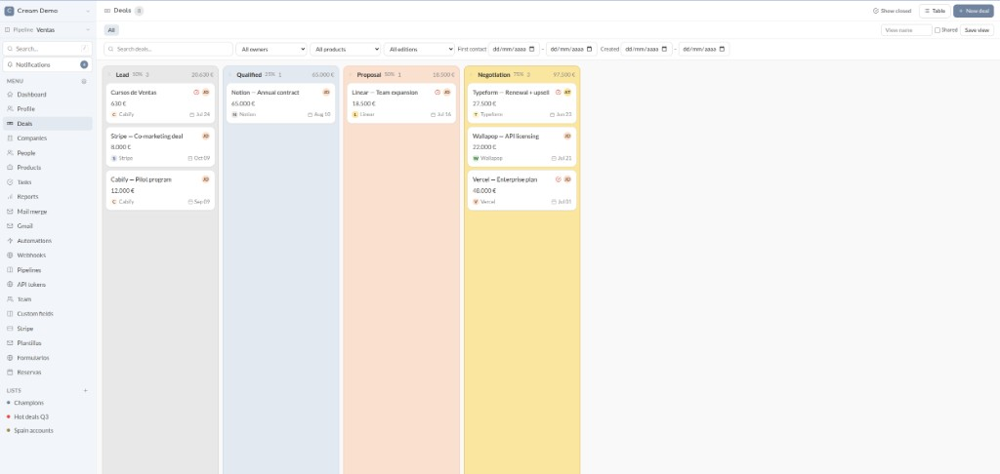

# Cream 🍦

**An open source CRM for teams**: people, companies and deals organized by workspace, with notes, tasks, lists and a shared activity timeline.

[](https://github.com/Entaina/cream/actions/workflows/ci.yml)
[](LICENSE)
[](.ruby-version)
[](Gemfile)

Built with **Rails 8.1**, **Hotwire (Turbo + Stimulus)**, **Tailwind CSS v4** and **PostgreSQL 16**. No Node build step — just importmap and tailwindcss-rails. Self-hosted with a single Docker image.



🎬 **[Watch the promo video](docs/cream-0.1-720p.mp4)**
## Quick start

Requirements: Ruby 3.4 and Docker (full details in [INSTALL.md](INSTALL.md)).

```bash
git clone https://github.com/Entaina/cream.git && cd cream
cp .env.example .env          # defaults work out of the box
docker compose up -d          # PostgreSQL on localhost:5470
bundle install
bin/rails db:prepare db:seed  # schema + demo workspace
bin/dev                       # http://localhost:3030
```

Log in with the demo credentials: `admin@example.com` / `creamcream` (or `member@example.com` / `creamcream`). The seed includes people, companies, deals, pipelines, email templates, lead forms and booking pages so you can explore everything right away.

## Features

### Core CRM

- **Multi-user workspaces** with registration, login, password recovery and optional Google OAuth (native Rails 8 authentication).
- **People, Companies and Deals** with sortable tables, global search (`/` shortcut) and filters by company, industry or stage.
- **Kanban pipeline board** with drag & drop, per-column totals, multiple pipelines and per-stage entry conditions.
- **Record pages** with attribute panel, notes, tasks, attachments and an automatic activity timeline (creation, field changes with diff, stage changes).
- **Tasks** with due dates, assignees, overdue highlighting and @mentions.
- **Typed lists**, **saved views** and **custom fields** (text, select, formula, record references and more).
- **Products and deal line items** — deal value computed from product lines.
- **CSV import and export** respecting the active filters.

### Sales and outreach

- **Email from records**: templates with variables, mail merge, scheduled send, follow-up reminders, open/click tracking and optional send-as-Gmail with reply logging.
- **Public lead capture forms** with anti-spam protection (honeypot, time-trap, rate limiting, optional Cloudflare Turnstile) and pipeline routing.
- **Booking pages** (Calendly-style) backed by Google Calendar, with event types, availability windows and automatic deal creation.
- **Reports** with CSV export and scheduled email delivery.

### Automation and integrations

- **Automations** (trigger + conditions + actions), **stage triggers** and **webhooks**.
- **Stripe payment reconciliation** — import charges and match them to deals.
- **Gmail add-on** to link Gmail threads to deals from the Gmail sidebar ([gmail_addon/](gmail_addon/)). Organization install: [below](#gmail-add-on-install-for-the-organization).
- **REST API with token authentication** and an **MCP server** so AI agents can operate the CRM.

### AI (optional)

- **Sales briefings** and a **contextual assistant** with a Google Drive knowledge base and per-user agent memory.
- Works with any OpenAI-compatible API; all AI features stay hidden until you set `CREAM_AI_API_KEY`.

See the **[User Manual](USER_MANUAL.md)** for a complete tour ([versión en español](MANUAL_USUARIO.md)).

## Tests

```bash
bin/rails db:test:prepare
bundle exec rspec   # external HTTP calls and jobs are mocked
bin/rubocop         # style (rubocop-rails-omakase)
```

## Project structure

- Core models in `app/models` with the `CrmRecord` (shared associations) and `Trackable` (automatic timeline) concerns.
- Design tokens and CSS components in `app/assets/tailwind/application.css`.
- Development skills for AI coding agents in `.claude/skills/` (environment, architecture, browser verification).

## Documentation

| Document | Contents |
|---|---|
| [INSTALL.md](INSTALL.md) | Requirements, local setup, environment variables, optional features |
| [USER_MANUAL.md](USER_MANUAL.md) | End-user documentation (English) |
| [MANUAL_USUARIO.md](MANUAL_USUARIO.md) | End-user documentation (Spanish) |
| [deploy/README.md](deploy/README.md) | Production deployment (Docker, GitHub Actions, Traefik) |
| [deploy/GMAIL_ADDON_SETUP.md](deploy/GMAIL_ADDON_SETUP.md) | Gmail add-on: Apps Script, Marketplace listing, organization install |
| [CONTRIBUTING.md](CONTRIBUTING.md) | How to contribute |
| [SECURITY.md](SECURITY.md) | Reporting vulnerabilities |

## Deployment

Production runs as a Docker Compose stack (app + PostgreSQL + Traefik with Let's Encrypt), with images published to GHCR and automatic deployment on push to `main` via GitHub Actions. See [deploy/README.md](deploy/README.md).

## Gmail add-on: install for the organization

The add-on is a **private** Google Workspace Marketplace app. Publishing the listing and installing it for the organization are different steps. Full guide: [deploy/GMAIL_ADDON_SETUP.md](deploy/GMAIL_ADDON_SETUP.md).

A Cloud project Owner can publish the listing. Only a Google Workspace **Marketplace administrator** can install it for the domain. That privilege is not the super-admin role and it is not the Cloud project Owner.

### Where it shows up

| Place | Meaning |
|---|---|
| [mydomainapps](https://workspace.google.com/marketplace/mydomainapps) | The private listing is **published**. People in the domain can install it themselves. This does not mean an admin installed it for the organization. |
| Admin console → **Apps → Google Workspace Marketplace apps → Apps list** | Apps an administrator **installed for the organization** or **allowlisted**. CReaM missing here means there is no domain install. Without the Marketplace administrator privilege the list is empty. |

A **test deployment** (Apps Script → Deploy → Test deployments) appears in neither list. It runs for the script owner only. Any other account sees **You need access** / **Necesitas acceso** with **Viewer** / **Editor**. That page is Drive sharing for the Apps Script project, not the Gmail consent screen. Do not approve it and do not share the project. Viewer can read the source. Editor can change the code and the script properties (`CREAM_CLIENT_ID`).

### Install for the domain

1. Sign in with a Marketplace administrator account.
2. Open [mydomainapps](https://workspace.google.com/marketplace/mydomainapps), or Admin console → **Apps → Google Workspace Marketplace apps → Apps list** → **Install app**.
3. Open **CReaM** → **Admin install** → the whole organization, an OU, or groups.
4. Accept the permissions.

If policy blocks internal apps: Admin console → **Apps → Google Workspace Marketplace apps → Settings** → allow internal Marketplace apps, or add CReaM to the allowlist.

CReaM then appears under **Domain installed apps**. Each person still clicks **Connect with CReaM** once. The organization install does not replace that per-user OAuth to Cream.

An install done by each user from `mydomainapps` is an individual install. It does not create a domain **Grant access** button.

### Scopes

| Scope | What it covers |
|---|---|
| `gmail.addons.execute` | Run the add-on |
| `gmail.addons.current.message.readonly` | The open message and the other messages in that same Gmail thread |
| `script.external_request` | Call the Cream API |

The manifest does not request `gmail.readonly`. A domain install does not share the Apps Script project. Requesting that scope opens the project file, so users still see **You need access** (Viewer/Editor) after the organization install. Do not share the project. Search outside the open thread (same subject, other threads, calendar files the message itself does not carry) is not part of the add-on.

If a later version adds some other OAuth scope, Google does not notify the admin. **Data access** shows **Partially granted** and an administrator grants it in the Admin console. Cloud Console cannot do that, and that grant still does not give access to the script file.

## Contributing

Contributions are welcome! Please read [CONTRIBUTING.md](CONTRIBUTING.md) for the development setup, project conventions and pull request flow.

## License

Cream is released under the [MIT License](LICENSE).
